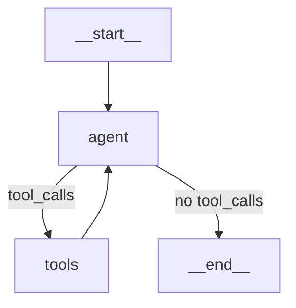

# LangGraph Stateful Agent Tutorial

This tutorial demonstrates how to build a **stateful agent workflow** using LangGraph with Azure OpenAI.

## What is LangGraph?

LangGraph is a library for building **graph-based agent workflows**. Unlike the ReAct pattern (a single reasoning loop), LangGraph gives you explicit control over:

| Component | Description |
|-----------|-------------|
| **State** | A typed dictionary that persists across all steps |
| **Nodes** | Functions that read/modify state (LLM calls, tool execution) |
| **Edges** | Connections between nodes (can be conditional) |
| **Graph** | The compiled workflow that orchestrates everything |

## Why LangGraph over AgentExecutor?

| Feature | AgentExecutor | LangGraph |
|---------|---------------|-----------|
| Control flow | Implicit loop | Explicit graph |
| Debugging | Limited visibility | Full state inspection |
| Complex workflows | Basic | Branching, cycles, parallel |
| Human-in-the-loop | Manual | Built-in support |
| Persistence | Manual | Built-in checkpointing |
| Streaming | Basic | First-class support |

## Graph Architecture

This agent uses a simple but powerful graph structure:



### Flow Explanation

1. **Start** → Graph begins at the `agent` node
2. **Agent** → LLM decides: call tools or give final answer
3. **Conditional Edge**:
   - If `tool_calls` present → route to `tools` node
   - If no `tool_calls` → route to `END`
4. **Tools** → Execute the requested tools
5. **Loop** → Return to `agent` with tool results
6. **End** → Final answer is ready

## Key Concepts

### 1. State Definition

```python
class AgentState(TypedDict):
    messages: Annotated[Sequence[BaseMessage], operator.add]
```

The `Annotated[..., operator.add]` pattern means new messages are **appended** to the list rather than replacing it.

### 2. Nodes

Nodes are functions that take state and return state updates:

```python
def agent_node(state: AgentState) -> dict:
    response = llm_with_tools.invoke(state["messages"])
    return {"messages": [response]}  # Appends to messages
```

### 3. Conditional Routing

```python
def should_continue(state: AgentState) -> Literal["tools", "end"]:
    last_message = state["messages"][-1]
    if last_message.tool_calls:
        return "tools"
    return "end"
```

### 4. Graph Construction

```python
workflow = StateGraph(AgentState)
workflow.add_node("agent", agent_node)
workflow.add_node("tools", tool_node)
workflow.set_entry_point("agent")
workflow.add_conditional_edges("agent", should_continue, {...})
workflow.add_edge("tools", "agent")
graph = workflow.compile()
```

## Tools in This Example

| Tool | Description | Input | Output |
|------|-------------|-------|--------|
| `get_weather` | Returns weather for a city | `city: str` | Weather description |
| `multiply` | Multiplies two numbers | `first_number: int, second_number: int` | Product |
| `get_word_length` | Counts characters in a word | `word: str` | Length |

## Prerequisites

1. **Azure OpenAI Resource** with a deployed chat model (e.g., GPT-4)
2. **Azure CLI** logged in (`az login`)
3. **Environment variables** in `.env`:

```env
OPENAI_API_VERSION=2024-02-15-preview
AZURE_OPENAI_ENDPOINT=https://your-resource.openai.azure.com/
AZURE_DEPLOYMENT_LLM=gpt-4
```

## Installation

```bash
# Create virtual environment
python -m venv .venv
.venv\Scripts\activate  # Windows
# source .venv/bin/activate  # Linux/Mac

# Install dependencies
pip install -r requirements.txt
```

**Note:** This tutorial requires `langgraph` which should be in your requirements.txt.

## Running the Script

```bash
python 3langgraph_agent.py
```

## Examples Demonstrated

### Example 1: Simple Tool Call
```
📝 Question: What's the weather in Warsaw?

🤖 [Agent Node] Calling LLM...
   → Routing to TOOLS (tools requested: ['get_weather'])
🤖 [Agent Node] Calling LLM...
   → Routing to END (final answer ready)

✅ Final answer: The weather in Warsaw is snowy, -2°C, with heavy snowfall.
```

### Example 2: Multi-Step Reasoning
```
📝 Question: How many letters in 'intelligence'? Multiply that by 7.

🤖 [Agent Node] Calling LLM...
   → Routing to TOOLS (tools requested: ['get_word_length'])
🤖 [Agent Node] Calling LLM...
   → Routing to TOOLS (tools requested: ['multiply'])
🤖 [Agent Node] Calling LLM...
   → Routing to END (final answer ready)

✅ Final answer: The word 'intelligence' has 12 letters. 12 × 7 = 84.
```

### Example 3: No Tool Needed
```
📝 Question: What is the capital of France?

🤖 [Agent Node] Calling LLM...
   → Routing to END (final answer ready)

✅ Final answer: Paris
```

## Inspecting State

LangGraph gives you full access to the execution trace:

```python
final_state = graph.invoke({"messages": [HumanMessage(content="...")]})

for i, msg in enumerate(final_state["messages"]):
    print(f"[{i}] {type(msg).__name__}: {msg.content}")
```

Output:
```
[0] HumanMessage: What's 7 times 8?
[1] AIMessage: (tool call: multiply)
[2] ToolMessage: 56
[3] AIMessage: 7 times 8 equals 56.
```

## Graph Visualization

LangGraph can generate Mermaid diagrams:

```python
print(graph.get_graph().draw_mermaid())
```

## Comparison: ReAct vs LangGraph

| Aspect | ReAct (AgentExecutor) | LangGraph |
|--------|----------------------|-----------|
| Code structure | Single executor | Explicit graph |
| Visibility | `verbose=True` | Full state access |
| Customization | Limited hooks | Custom nodes/edges |
| Error handling | `handle_parsing_errors` | Custom error nodes |
| Best for | Simple agents | Complex workflows |

## Next Steps

- Add **memory/persistence** with checkpointing
- Implement **human-in-the-loop** approval steps
- Create **parallel tool execution** branches
- Add **streaming** for real-time output

## References

- [LangGraph Documentation](https://langchain-ai.github.io/langgraph/)
- [LangGraph Tutorials](https://langchain-ai.github.io/langgraph/tutorials/introduction/)
- [LangGraph vs AgentExecutor](https://langchain-ai.github.io/langgraph/how-tos/migrate-agent-executor/)
